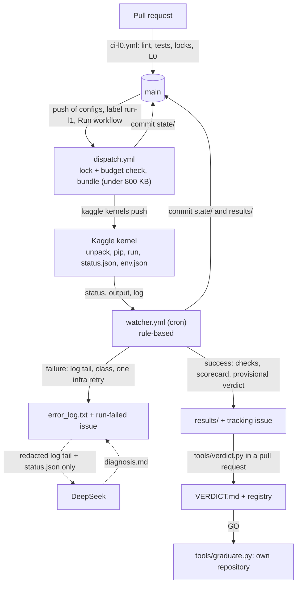
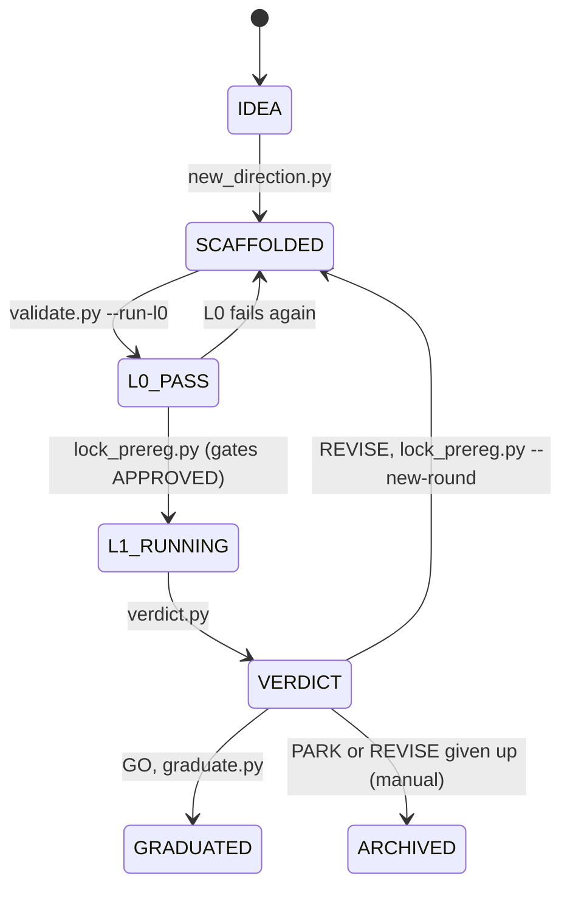

# Architecture

## Who does what

| Role | Does | Never does |
|---|---|---|
| Kaggle | executes one self-contained script kernel | holds GitHub credentials |
| Dispatcher (`dispatch.yml`) | checks lock and budget, bundles, pushes, records | runs pull-request code on the runner |
| Watcher (`watcher.yml`, rules only) | polls, downloads, checks, classifies, retries infra once, reports | changes code, configs or gates |
| DeepSeek (optional) | summarises a redacted log tail into `diagnosis.md` | edits, re-runs or sees data |
| Claude Code (local or `@claude`) | writes code and tests in pull requests | merges, decides verdicts, edits `state/` or `results/` |
| Verdict script | applies the locked gates to a scorecard | anything judgemental |
| You | approve gates, merge, label runs, graduate | |

## Data flow

## Lifecycle

`registry.yaml` is authoritative; each `direction.yaml` mirrors the status and `validate.py` checks that
they agree. There is no archive tool: set `status: ARCHIVED` in both files in a pull request and leave the
lock in place.

## Pre-registration lock

- `lock_prereg.py` requires L0 to have passed on the current code, and `gates.approval: APPROVED`.
- The lock is one sha256 over `prereg.md`, `checks.py` and every file under `src/` (LF line endings),
  the `gates` and `scorecard_map` blocks (canonical JSON) and `labcore.__version__` (hash scheme 2,
  recorded as `hash_scheme` in the lock). A lock without that field is scheme 1 and covers only
  `src/evaluate.py` of `src/`; it is still checked that way, so earlier locks stay valid.
  Because all of `src/` is covered, any edit there after the lock breaks it: fix `requirements.txt`
  or a config without a run instead, or open a new round.
- While a direction is `L1_RUNNING` the current labcore version counts, so a version bump breaks its
  lock. A finished direction is compared under the version recorded in its lock (`stats_version`).
  `tests/test_stats_version.py` fails if `labcore/stats` changes without a bump.
- Dispatch to Kaggle refuses without an intact lock; every run records the hash and the round.
- CI refuses a pull request that changes a locked hash, rewrites a lock, lowers the round count or moves
  a direction back out of L1. A REVISE verdict is the only way to a new round, up to `max_l1_rounds`.
- **Not covered:** the rest of `src/` (data, preprocessing, arms, folds, training, `main.py`), configs,
  and `labcore` edits without a version bump, including `labcore/verdict`. Review those changes
  yourself (see `CLAUDE.md`).

## The kernel bundle

One Python script holding a base64 tar.gz of `labcore/` and the direction (without `notebooks/`, `tests/`,
`results/`, other configs, data-like or secret files). It is deterministic: equal code gives an equal
`bundle_hash`. At run time it unpacks, installs only missing requirements, calls the entrypoint
`run(config_path, out_dir)` and writes to `/kaggle/working/out/`:

- `status.json`: stage, time, `ok`, error type and traceback tail, rewritten at every stage;
- `env.json`: GPU name, torch version, run ID, commit, config hash;
- the direction's declared `outputs`.

## What a run leaves behind

`results/<slug>/<exp>/<run_id>/` holds only the declared outputs plus `status.json` and `env.json`
(data-like files, files over 5 MB and CSV/JSON files with phenotype-like column names are refused),
then `checks.json`, and either `scorecard.json` (and `verdict.json`, provisional) or `error_log.txt`
and `diagnosis.md`. The column check (`labcore.privacy`) also runs in L0 and in CI over all of
`results/`. It reads names, not values, and does not cover log text.

A run is `QUEUED`, `RUNNING` or `UNKNOWN` while active, and ends as `COMPLETE`, `COMPLETE_INVALID`
(checks failed), `ERROR`, `TIMEOUT` (over twice the estimate, at most 11.5 h) or `CANCELLED`.
The record is saved as finished before anything is announced, so the watcher can run any number of times.

## CI

`ci-l0.yml` lints, validates, checks protected paths, locks and result columns, and runs the root tests.
It then runs L0 for each changed direction, or for every direction if anything under `labcore/` changed.

## State and concurrency

`state/runs.json`, `queue.json` and `gpu_budget.json` are validated against
`labcore/schemas/runs.schema.json` on every read and write. `dispatch.yml` and `watcher.yml` share the
concurrency group `lab-state`, so only one job writes them at a time. Budget: dispatch reserves the
estimate, the watcher replaces it with the hours used; the week resets on `reset_weekday`.

## Code map

| Package | Contents |
|---|---|
| `labcore.kaggle` | `bundle`, `metadata`, `client` (CLI wrapper), `local_backend`, `entrypoint_template` |
| `labcore.runs` | `dispatch`, `state` |
| `labcore.watcher` | `watcher`, `checks`, `classify` |
| `labcore.verdict` | `gates` (parser, no `eval`), `prereg`, `verdict` |
| `labcore.stats` | `paired`, `scorecard` |
| `labcore.diagnose`, `labcore.notify` | DeepSeek summary; GitHub issues and Telegram |
| `labcore.privacy` | column names that may not reach `results/` |
| `labcore.testing` | helpers for each direction's L0 test |
